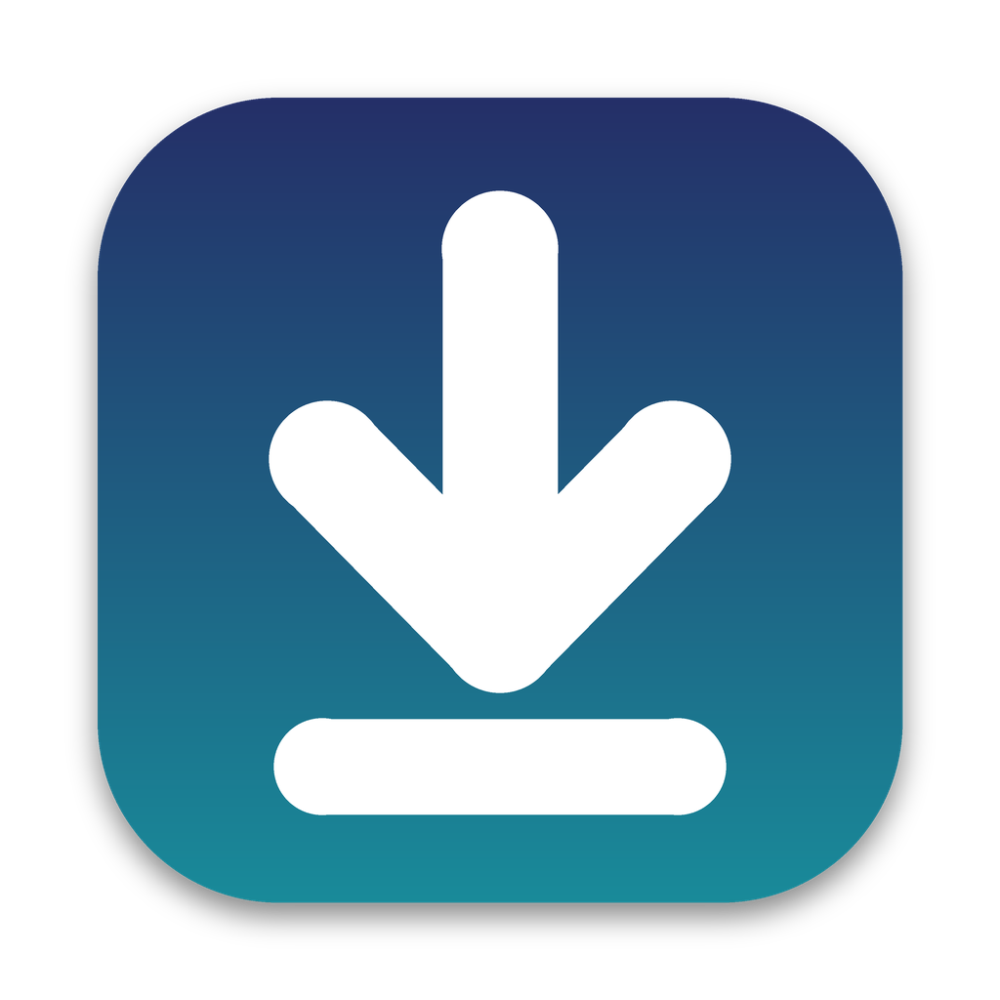

<p align="center">
  
</p>

<h1 align="center">SmartDock</h1>

<p align="center">
  A tiny menu bar app that hides your Dock when a window gets in its way, and brings it back when the coast is clear.
</p>

---

SmartDock is a free, open-source alternative to IntelliDock. It lives in the menu bar and toggles Dock auto-hide for you:

- **No window in the way:** the Dock stays visible.
- **A window overlaps (or is maximized over) the Dock:** the Dock hides itself.

No manual toggling, no `killall Dock` flicker.

## Features

- **Instant toggling.** Flips auto-hide directly instead of restarting the Dock, so there's no flash or lag.
- **Multi-monitor aware.** Only watches the display the Dock is actually on, so windows on your other monitors don't make it hide. Plugging, unplugging, or rearranging displays is handled.
- **Any Dock position.** Bottom, left, or right, at any size.
- **Debounced.** Short delays stop the Dock from flapping when you drag windows around.
- **Two modes.** Hide on *any* overlap (IntelliDock-style), or only for near-maximized windows.
- **Ignore list.** Exclude apps with overlay or helper windows that cause false hides.
- **Respects your setup.** Restores your original auto-hide setting when you quit, and even after a crash or `kill`.
- **Launch at Login** (macOS 13+).
- **No special permissions.** No Accessibility, no Screen Recording.

## Requirements

- macOS 11 Big Sur or later
- Apple Silicon or Intel (Intel needs a universal build, see below)

## Install

### Download

Grab the latest `SmartDock-x.y.z.dmg` from [Releases](../../releases), open it, and drag SmartDock to Applications.

If the build isn't notarized, macOS will warn on first launch. Right-click the app, choose **Open**, then **Open** again. Or run:

```sh
xattr -cr /Applications/SmartDock.app
```

### Build from source

You only need Xcode or the Command Line Tools (`xcode-select --install`).

```sh
git clone https://github.com/YOUR_USERNAME/SmartDock.git
cd SmartDock
bash build.sh
open SmartDock.app
```

Other build options:

```sh
UNIVERSAL=1 bash build.sh      # Apple Silicon + Intel (needs full Xcode)
bash make_dmg.sh               # package a DMG
```

To sign and notarize for distribution:

```sh
xcrun notarytool store-credentials smartdock --apple-id YOU@EMAIL --team-id TEAMID --password APP-SPECIFIC-PASSWORD

SIGN_ID="Developer ID Application: Your Name (TEAMID)" bash build.sh
SIGN_ID="Developer ID Application: Your Name (TEAMID)" NOTARY_PROFILE=smartdock bash make_dmg.sh
```

## Usage

Click the menu bar icon:

| Item | What it does |
| --- | --- |
| **Enabled** | Turn SmartDock on or off. Turning it off restores your original Dock setting. |
| **Hide when any window overlaps the Dock** | Default mode. |
| **Hide only for maximized-size windows** | Ignores small windows that merely touch the Dock area. |
| **Ignore "App"** | Adds the frontmost app to the ignore list. |
| **Ignored Apps** | Remove apps from the ignore list. |
| **Launch at Login** | Start SmartDock when you log in (macOS 13+). |

## How it works

1. A light timer (plus Space, app-switch, and wake events) reads the on-screen window list with `CGWindowListCopyWindowInfo`. This gives window positions without needing Screen Recording access.
2. It works out where the Dock strip is. While the Dock is visible, it measures the real Dock thickness and which display it's on; otherwise it uses your Dock preferences.
3. If a normal window overlaps that strip, it turns Dock auto-hide on. When nothing overlaps, it turns it off.
4. The change is debounced and only applied when the state actually changes.

Auto-hide is toggled through `CoreDockSetAutoHideEnabled`, a private but long-stable system call also used by tools like Hammerspoon. If it's ever unavailable, SmartDock falls back to a System Events AppleScript, which asks for Automation permission once.

## Known limitations

- Because it uses a private API, a future macOS release could change it. The AppleScript fallback is there for that case.
- While the Dock is auto-hidden, SmartDock can't see which display it will pop up on. It re-learns the Dock's display whenever the Dock is visible.
- Apps with invisible full-screen overlay windows can trigger false hides. Use **Ignore** for those.

## Icon variants

The default icon is built from `icon.png`. `SmartDock.icon` is a layered Icon Composer package that lets macOS 26+ show Dark, Clear, and Tinted styles. `build.sh` compiles it automatically when full Xcode 26+ is installed. `make_icon.py` regenerates all icon files (needs Pillow).

## License

MIT. See [LICENSE](LICENSE).
